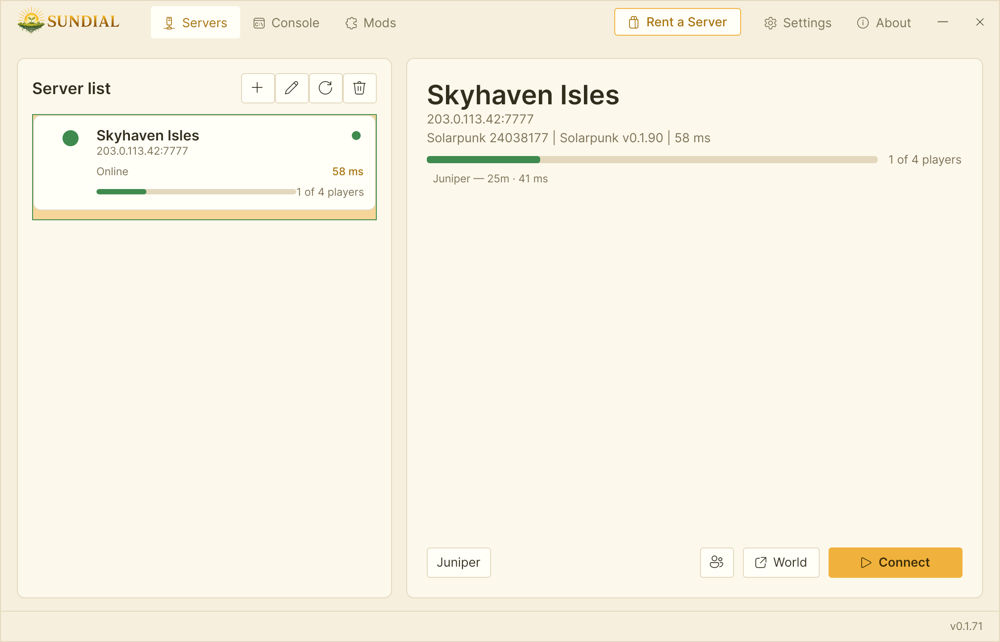

  

  
  
  
  
  

# Sundial

**Solarpunk** has no dedicated server. Its multiplayer is a session hosted from one player's copy of the game, so the world is only online while that player is. Sundial adds a Solarpunk dedicated server: [SundialServer](https://github.com/HumanGenome/SundialServer) runs the game headless on a Windows machine with a public IP and port, and the Sundial app connects players to it by address.

Every player must install Sundial to join a Sundial server. Stock Solarpunk cannot connect to a Sundial server directly.

  

## Features

### 🧭 Join by address
Add the server's IP or hostname and its gameplay port, pick a character and click Connect. The app installs its connection mod into your game, starts Solarpunk and joins the server. It also shows whether the server is up and who is on it.

### 🧑‍🌾 Your own characters
Each character name gets its own save on the server, so several people, or one person with several characters, keep separate progress in the same world. The app remembers which character you used on each server.

### 🔒 Join password
Solarpunk has no join password of its own, so Sundial adds one. Set it on the server and every remote join is checked against it; anyone who doesn't match is kicked. A server that cannot load its password check shuts itself down instead of running open.

### 🛠 Admin console
The app has a Console tab for the server's RCON: `status`, `players`, `say`, `announce`, a message of the day, and `ban`, `unban` and `bans`.

### 🔁 World snapshots
Admins take and list world snapshots over RCON (`save snapshot`, `save list`) and restore one from the app's World backups dialog, with a snapshot taken first so the restore can be undone.

### 🗺 Player map
The server serves a live page at `/map/` that plots where each connected player is, and a player list over HTTP.

### 💬 Server chat feed
The server keeps a chat feed with a message of the day and admin broadcasts, readable over RCON and HTTP. There is no in-game chat window yet.

### 🧩 Server mod list
UE4SS mods load on both the players' games and the server. Each server publishes which mods are required, recommended or blocked, and the app shows that list for the server you select.

### 📡 Server query
The server answers Source A2S query, so server lists, monitoring tools and Discord bots can read its status and player count.

## Install

### Managed hosting
[SurvivalServers.com Solarpunk hosting](https://www.survivalservers.com/services/game_servers/solarpunk/?utm_source=github&utm_medium=readme_install&utm_campaign=sundial) runs SundialServer for you, handles the ports and gives players a one-click setup link.

### Players
1. Download `SundialSetup-latest.exe` from the [latest release](https://github.com/HumanGenome/Sundial/releases/latest).
2. Run the installer. Windows SmartScreen may warn because the installer is not code-signed yet; choose **More info**, then **Run anyway**.
3. Open Sundial, click **Add Server** and enter the server's address, gameplay port and password if it has one.
4. Pick a character name and click **Connect**.

Sundial checks for app updates when it starts and while it runs.

### Self-hosted servers
Download `SundialServer-v<version>.zip` from the [SundialServer releases](https://github.com/HumanGenome/SundialServer/releases/latest) and follow its [installation steps](https://github.com/HumanGenome/SundialServer#installation). The host needs the Solarpunk game files from your own copy, either your Steam folder or a SteamCMD install with an account that owns the game.

## Releases

This repo publishes the player installer, `SundialSetup-<version>.exe`, and a portable zip of the app. The server package, `SundialServer-v<version>.zip`, is published on the [SundialServer releases](https://github.com/HumanGenome/SundialServer/releases/latest). To play on someone else's server you only need the installer.

## Source

Sundial is split into two repos: **Sundial** (this repo) carries the player app's releases and documentation, and **[SundialServer](https://github.com/HumanGenome/SundialServer)** is the open-source dedicated server.

## FAQ

### Is Linux supported?
No. The app and the server are Windows only (Windows 10, 11 or Server, 64-bit). The server launches the Windows build of Solarpunk.

### Is there in-game chat?
Not yet. The server keeps a chat feed, a message of the day and admin broadcasts, which you can read over RCON and HTTP, but players have no chat window in the game.

### Why does Windows warn about the installer?
The installer is not code-signed yet. Each release lists the SHA-256 of its downloads in `checksums-launcher.txt`, so you can check the file you got before running it.

## Contributing

Bug reports are welcome; [CONTRIBUTING.md](CONTRIBUTING.md) lists what to include. Server problems belong on [SundialServer](https://github.com/HumanGenome/SundialServer/issues).

## Community Note

Sundial is a community project and is not affiliated with or endorsed by the developers of Solarpunk.

## License

MIT. See [LICENSE](LICENSE).

## Credits

- [UE4SS](https://github.com/UE4SS-RE/RE-UE4SS): Unreal Engine scripting and modding framework
- [Avalonia](https://avaloniaui.net/): .NET UI framework used by the Sundial app
