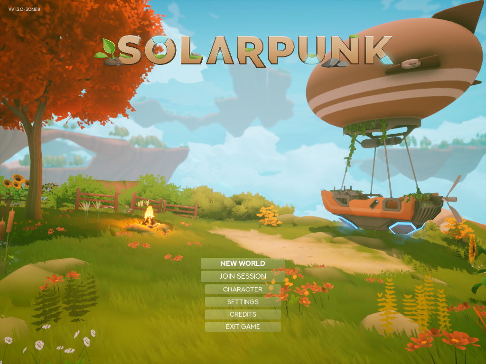
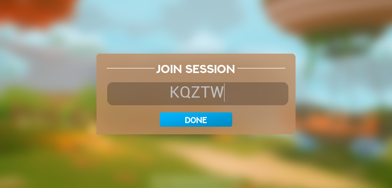

  

  
  
  
  
  
  

# Sundial

**Solarpunk** has no dedicated server. Its multiplayer is a session hosted from one player's copy of the game, so the world is online only while that player is playing. Sundial adds a Solarpunk dedicated server.

Players join with the game's own invite code and install nothing: they choose Join session on Solarpunk's main menu.

  

## Features

### 🔑 Join with an invite code
Every Sundial server has a 5-letter invite code. Players type it into Solarpunk's own Join session box, with no IP address to share. The server gets a new code each time it starts.

  

### Also built in
- **Upload a save.** Upload your single-player world and your group carries on in it. You keep your own character.
- **Saved before every stop.** The game saves by itself only every 2.5 minutes. Before the server stops or restarts, Sundial has the game save, so the last minutes of building aren't lost.
- **Crash restarts.** The server starts the game again if it stops unexpectedly.
- **World backups.** The server backs up the world on request and can restore an earlier backup, backing up the last saved world first.
- **Server console.** RCON for the server's status, the player list, kick, ban and world backups.
- **Shows up in server lists.** The server answers Source server queries, so a server list, monitoring tool or Discord bot given its address can read its name and player count.

## Install

### Rent a server
[SurvivalServers.com](https://www.survivalservers.com/services/game_servers/solarpunk/?utm_source=github&utm_medium=readme_install&utm_campaign=sundial) runs Solarpunk servers with SundialServer installed. Your server's invite code is in Command Center.

### Players
1. Get the server's 5-letter code from whoever runs the server.
2. In Solarpunk's main menu, choose **Join session**.
3. Type the code and press **Done**.

### Host your own
The SundialServer download doesn't support hosting your own server on the current Solarpunk version. The source code is on [SundialServer](https://github.com/HumanGenome/SundialServer).

## Releases

The server download, `SundialServer-v<version>.zip`, is on [SundialServer releases](https://github.com/HumanGenome/SundialServer/releases/latest). This repo's releases are the retired Sundial app, kept for reference.

## Source

**[SundialServer](https://github.com/HumanGenome/SundialServer)** is the open-source dedicated server, with its server mods and tests. This repo is the project's front page.

## FAQ

### Do players need to install anything?
No. Solarpunk's own Join session box takes the server's invite code.

### How many players can join?
Up to 4, the number Solarpunk's [Steam page](https://store.steampowered.com/app/1805110/) gives: "made for solo play and small group cooperative play (up to 4 players)".

### Why did the code change?
The server gets a new invite code each time it starts. Ask whoever runs the server for the current one.

### What happened to the Sundial app?
It was for Solarpunk before 1.3.0, when players joined a server by IP. Solarpunk 1.3.0 moved the game's multiplayer to Epic Online Services, and the app can't join a 1.3.0 server. Players don't need it: they join from the game's own Join session box. It gets no new releases.

### Where is my character saved?
On the server, in the world's save, under the game account you play with. Join again with the same account and your character and its inventory are there.

### Can I move a world to another server?
Yes. The world is one save file. Upload it to the new server and it becomes that server's world at its next start.

### Is Linux supported?
No. The server runs the Windows build of Solarpunk, so it needs Windows 10, 11 or Server (64-bit).

## Contributing

Bugs: [open an issue](https://github.com/HumanGenome/SundialServer/issues). [CONTRIBUTING.md](CONTRIBUTING.md) lists what to include.

## Community note

Sundial is a community project and is not affiliated with or endorsed by the developers of Solarpunk.

## License

MIT. See [LICENSE](LICENSE).

## Credits

- [UE4SS](https://github.com/UE4SS-RE/RE-UE4SS): the Unreal Engine scripting framework the server mods run on
