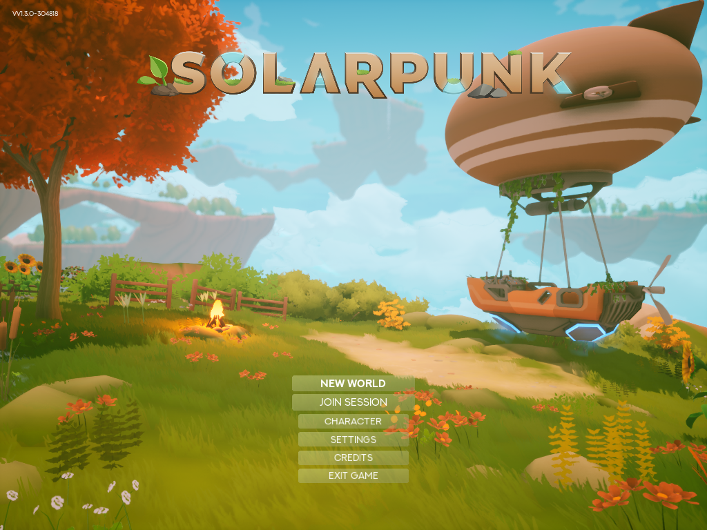
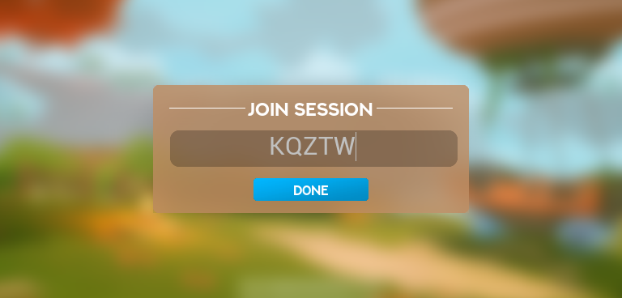

  

  
  
  
  
  
  

# Sundial

**Solarpunk** has no dedicated server. Its multiplayer is a session hosted from one player's copy of the game, so the world is online only while that player is playing. Sundial adds a Solarpunk dedicated server: [SundialServer](https://github.com/HumanGenome/SundialServer) runs the game headless on a Windows machine with an Epic identity of its own, so the world stays online with nobody hosting it from their PC.

Players join with the game's own invite code and install nothing. Stock Solarpunk joins a Sundial server from its Join session screen.

  

## Features

### 🔑 Join with an invite code
Every Sundial server has a 5-letter invite code. Players type it into Solarpunk's own Join session box: there is no address to share and nothing to install. The server gets a new code each time it starts.

  

### Also built in
- **Bring your single-player world.** Upload a save from your single-player game and the group carries on in that world. The owner keeps their own character.
- **Saved before every stop.** The game saves on its own only every two and a half minutes. When the server is stopped or restarted, Sundial has the game save first, so the last minutes of building are not lost.
- **Crash restarts.** The server starts the game again if it stops unexpectedly.
- **World backups.** The server snapshots the world on request and can put an earlier snapshot back, saving the running world as a snapshot first.
- **Server console.** Source RCON for the server's status, its player count and world snapshots.
- **Shows up in server lists.** The server answers Source server query, so server lists, monitoring tools and Discord bots can read its name and player count.
- **One Epic identity per server**, so several servers on one machine never share an address.

## Install

### Rent a server
[SurvivalServers.com Solarpunk hosting](https://www.survivalservers.com/services/game_servers/solarpunk/?utm_source=github&utm_medium=readme_install&utm_campaign=sundial) runs SundialServer for you and shows the server's invite code in its control panel.

### Players
1. Get the server's 5-letter code from whoever runs the server.
2. In Solarpunk's main menu, choose **Join session**.
3. Type the code and press **Done**.

### Self-hosted servers
Self-hosting on the current Solarpunk version is not supported by the public package. The server source is on [SundialServer](https://github.com/HumanGenome/SundialServer).

## Releases

The server package, `SundialServer-v<version>.zip`, is published on the [SundialServer releases](https://github.com/HumanGenome/SundialServer/releases/latest). This repo's releases are the retired Sundial app, kept for reference.

## Source

**[SundialServer](https://github.com/HumanGenome/SundialServer)** is the open-source dedicated server: the supervisor, the in-game server mods and their tests. This repo is the project's front page.

## FAQ

### Do players need to install anything?
No. Solarpunk's own Join session box takes the server's invite code.

### How many players can join?
Up to four, the number Solarpunk's [Steam page](https://store.steampowered.com/app/1805110/) gives: "made for solo play and small group cooperative play (up to 4 players)".

### Why did the code change?
The server gets a new invite code each time it starts. Ask the host for the current one.

### What happened to the Sundial app?
It was for Solarpunk before 1.3.0, when players joined a server by address. Solarpunk 1.3.0 moved the game's multiplayer to Epic Online Services, and the app cannot join a 1.3.0 server. Players do not need it: they join from the game's own Join session box. It gets no new releases.

### Where is my character saved?
On the server, in the world's save, under the game account you play with. Join again with the same account and your character and its inventory are there.

### Can I move a world to another server?
Yes. The world is one save file; upload it to the new server and it becomes that server's world at its next start.

### Is Linux supported?
No. The server runs the Windows build of Solarpunk, so it needs Windows 10, 11 or Server (64-bit).

### Is this official?
No. Sundial is an independent project, not made by the developers of Solarpunk.

### Something broke
Open an issue on [SundialServer](https://github.com/HumanGenome/SundialServer/issues) with the server's logs. If you rent a server, your host's support can help first.

## Contributing

Bug reports are welcome; [CONTRIBUTING.md](CONTRIBUTING.md) lists what to include. Server problems belong on [SundialServer](https://github.com/HumanGenome/SundialServer/issues).

## Community note

Sundial is a community project and is not affiliated with or endorsed by the developers of Solarpunk.

## License

MIT. See [LICENSE](LICENSE).

## Credits

- [UE4SS](https://github.com/UE4SS-RE/RE-UE4SS): the Unreal Engine scripting framework the server mods run on
